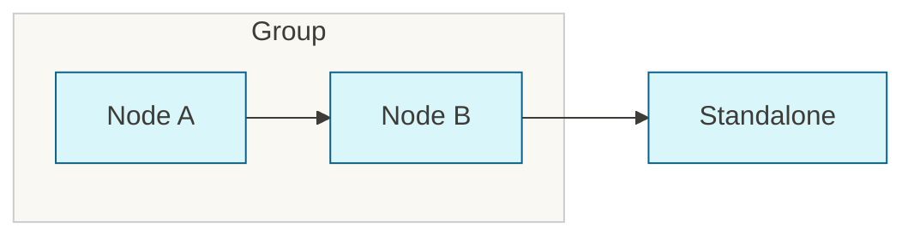

# Diagram Standards — Optum Brand (Mermaid v11)

## Scope

All Mermaid diagram blocks in Markdown files.

## When to Use

- Adding a new Mermaid diagram
- Editing an existing diagram
- Reviewing a PR that touches any file with ` ```mermaid ` blocks

## Design Tokens

| Role | Token | Hex | Usage |
|---|---|---|---|
| Page background | White | `#FFFFFF` | HTML page background only |
| Diagram canvas | Warm White | `#FAF8F2` | Subgraph / container backgrounds |
| Node fill | Sky Blue | `#D9F6FA` | All individual nodes (standalone and nested) |
| Primary text | Warm Gray | `#3D3C38` | All text in diagrams |
| Node border | Hyperlink | `#095F87` | Node stroke color |
| Container border | Border Gray | `#CBCCCD` | Subgraph/cluster stroke color |

## Procedure

### MUST

1. **MUST** start every diagram with an `%%{init}%%` block using this exact template:

```
%%{init: {'theme': 'base', 'themeVariables': {
  'background': '#FFFFFF',
  'primaryColor': '#D9F6FA',
  'primaryTextColor': '#3D3C38',
  'primaryBorderColor': '#095F87',
  'lineColor': '#3D3C38',
  'secondaryColor': '#FAF8F2',
  'secondaryTextColor': '#3D3C38',
  'secondaryBorderColor': '#CBCCCD',
  'tertiaryColor': '#D9F6FA',
  'tertiaryTextColor': '#3D3C38',
  'tertiaryBorderColor': '#095F87',
  'clusterBkg': '#FAF8F2',
  'clusterBorder': '#CBCCCD',
  'noteBkgColor': '#FAF8F2',
  'noteTextColor': '#3D3C38',
  'noteBorderColor': '#CBCCCD'
}}}%%
```

2. **MUST** add an explicit `style` directive for every node:
   - Standalone node: `style NodeID fill:#D9F6FA,color:#3D3C38,stroke:#095F87`
   - Node inside a subgraph: `style NodeID fill:#D9F6FA,color:#3D3C38,stroke:#095F87`
   - Subgraph container: `style SubgraphID fill:#FAF8F2,color:#3D3C38,stroke:#CBCCCD`

3. **MUST** run `npm run validate:diagrams` (or `node scripts/validate-mermaid.mjs <file>`) and confirm 0 failures before committing

4. **MUST** use `flowchart LR` or `flowchart TD` — not `graph LR`/`graph TD` (deprecated Mermaid syntax)

### MUST NOT

1. **MUST NOT** use default Mermaid theme — always override with `%%{init}%%`
2. **MUST NOT** rely on theme variables alone for node colors — always add explicit `style` directives
3. **MUST NOT** use `fill:#blue` or named CSS colors — only hex codes from the design token table above
4. **MUST NOT** use `[last()]` XPath selectors in diagram IDs — use `[1]` patterns

### Box-Layer Rule

- **Standalone boxes** (not inside any subgraph): Sky Blue fill `#D9F6FA`
- **Subgraph containers** themselves: Warm White fill `#FAF8F2`
- **Nodes inside subgraphs**: Sky Blue fill `#D9F6FA` (same as standalone)

> Never nest Warm White inside Warm White — subgraphs inside subgraphs still use `#FAF8F2` container with `#D9F6FA` nodes inside.

## Validated Example


